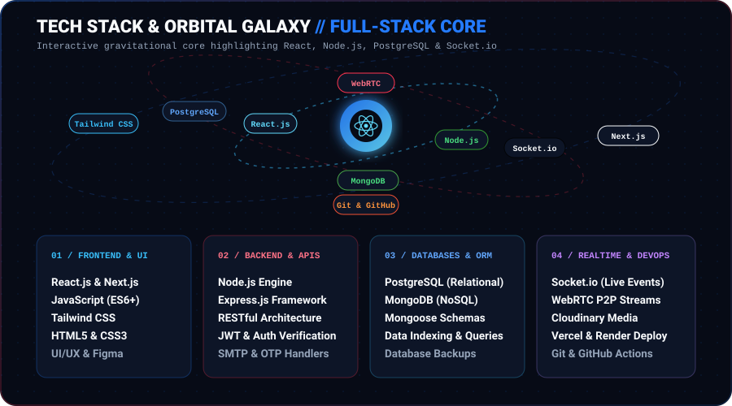

  <!-- Top Hero Banner with Terminal, Specialty Cycler & Verified Portrait -->
  

    

  <!-- Capabilities & Interests Carousel Banner -->
  

    

  <!-- Interactive Orbital Tech Stack & Production Tools -->
  

    

  <!-- Developer Identity Pass Lanyard Card -->
  

    

  <!-- Direct Connect & Collaboration Banner -->
  

 

### 🌐 Direct Connect & Professional Links

 

---

## 💻 Featured Full-Stack & Real-Time Projects

| Project | Tech Stack | Role & Architecture Summary | Live Link |
| :--- | :--- | :--- | :--- |
| **☕ Coffeely** | `React`, `Node.js`, `PostgreSQL`, `Socket.io`, `WebRTC`, `Cloudinary` | Social companion & coffee dating platform with role-based dashboards, P2P video/audio calls, live SOS GPS alerts, KYC document verification, and super admin suite. | [Live Demo](https://coffeely-app.vercel.app/#home) • [Code](https://github.com/Priyanshu-kumar-maurya/companion-app) |
| **🎮 Typing Fighter** | `JavaScript ES6`, `WebRTC`, `Socket.io`, `HTML5 Canvas`, `Audio API` | 1v1 real-time competitive type clash battle arena featuring 25-stage campaign, WebRTC P2P voice chat, and responsive mobile arcade controls. | [Live Demo](https://typing-fighter-game.vercel.app/) • [Code](https://github.com/Priyanshu-kumar-maurya/typing-fighter-game) |
| **🎪 EventHub** | `React`, `Node.js`, `Express`, `MongoDB`, `JWT Auth` | Enterprise event management system supporting custom vendor packages, automated invoice generators, real-time booking trackers, and organizer portals. | [Live Demo](https://event-planning-system-topaz.vercel.app/) • [Code](https://github.com/Priyanshu-kumar-maurya/Event-Planning-System-) |
| **🍽️ SmartQR Dine** | `React`, `Node.js`, `Express`, `PostgreSQL`, `WebSockets` | Contactless QR-code restaurant ordering portal enabling instant table scans, live kitchen order display, and dynamic bill settlement. | [Live Demo](https://hotel-qr-project.vercel.app/) • [Code](https://github.com/Priyanshu-kumar-maurya/Hotel-QR-Project) |
| **📚 LibraryPro** | `Node.js`, `Express`, `PostgreSQL`, `EJS`, `Tailwind CSS` | Digital university library system with automated book barcode issuing, overdue fines calculation, and role-based student/librarian panels. | [GitHub Repo](https://github.com/Priyanshu-kumar-maurya/library-project) |
| **🏎️ BMW 3D Studio** | `Three.js`, `WebGL`, `HTML5`, `CSS3 Canvas` | Interactive 3D automotive showroom with real-time lighting, paint customizer, interior inspection, and responsive 3D model controls. | [Live Showcase](https://priyanshu-kumar-maurya.github.io/Bio/) |

 

---

## 📊 Live GitHub Activity, Commits & Visitor Stats

  <!-- Live Profile Visitors Counter Badge -->
  

    

  <!-- GitHub Streak Stats (Commits Streak, Total Commits) -->
  

    

  <!-- Side-by-side Overall Activity & Top Languages -->
  

    
    
  

 

  Designed with ❤️ by <b>Priyanshu Kumar Maurya</b> • Built for scalable, high-performance web engineering

